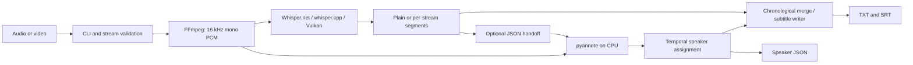

# Architecture

`src/WhisperTranscriber` is a single console application. Its partial `Program` class groups CLI parsing, media processes, model lookup, inference, Python integration and subtitle formatting into separate files. There is no web server or database.

The multitrack path extracts two explicitly selected audio streams in one FFmpeg process, transcribes them sequentially and sorts segments by start, end and source order. Overlaps remain intact. Source labels express where audio came from, so a desktop call with several people still receives one `Desktop` label.

The mixed path transcribes the first audio stream, passes the same prepared PCM audio to pyannote, and exchanges segment data as JSON. Python maps arbitrary model speaker IDs to names by earliest appearance. Each Whisper segment is assigned to the speaker with the greatest total overlap; a segment in a gap uses the nearest turn to its midpoint. This is segment-level alignment, not word-level speaker detection. `--speakers` requests a fixed count from the model; it does not establish the actual number of people.

Whisper inference loads only the Vulkan runtime package. The application checks which runtime library was loaded; the native log identifies the selected device/backend. Pyannote explicitly uses CPU. These are independent inference paths.

Preflight checks input existence, audio streams, optional Python/token availability and output conflicts before loading a model. External arguments use `ProcessStartInfo.ArgumentList`. Probe stdout/stderr are drained concurrently. Temporary audio/JSON lives in a unique system-temp directory and is removed in `finally`; failed diarization rescues plain subtitles beside the intended outputs.
